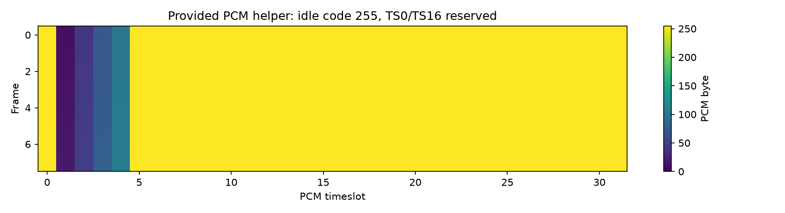

# 实验一报告

姓名：姚智烁  学号：2024280127  GitHub：yzs7014  提交编号：（PR 编号，创建后填写）

## 实验目的

在完全相同的业务输入、链路容量（128 kbit/s）、缓存容量（4096 bit 有效载荷）和观察时长（256 tick）下，比较固定时隙电路交换与共享 FIFO 分组交换的资源利用率、完成时延、丢失与积压，说明效率和时延如何随业务模式变化，并理解不能预设某种方式总是更优。

## 原理和模型

- 电路交换：预先为每个用户保留周期性的固定时隙，本实验用 `tick % users` 决定每 tick 服务哪个用户；用户无数据时时隙仍空闲，其他用户不能借用。
- 分组交换：所有记录附加 32 bit 包头后进入共享 FIFO，任何用户有数据都可占用链路（统计复用）；队首发完才处理下一条，大分组可跨 tick 续传而不重加包头。
- 缓存准入：两模型都按“未完成记录的原始 payload”预留 4096 bit 空间，放不下时整条记录尾丢弃；完整交付才释放。包头只增加线路开销，不占 payload 配额。
- 有限观察窗口：只统计 `[0, 256)` tick，不追加排空；窗口结束时未完成记录计积压（backlog），不算丢包。
- 抽象链路与 PCM 示例的区别：仿真链路是 128 kbit/s 的单链路抽象；PCM 工具是附带教学示例，32 时隙 × 8 bit × 8000 帧/s = 2.048 Mbit/s，二者不是同一速率模型，不能混用。

## 手工推演

配置：users=2、ticks=2、slot_bits=8、header_bits=4。tick0 到达：用户0 生成 10 bit，用户1 生成 8 bit（按输入顺序）。

电路交换（`tick % 2` 决定服务用户）：

| tick | 服务用户 | 动作 | 本 tick 完成 |
|---|---|---|---|
| 0 | 用户0 | 发 8 bit，剩 2 bit | 无 |
| 1 | 用户1 | 发 8 bit，完成（时延 2） | 用户1 |

结果：交付 8 bit（用户1），积压 10 bit（用户0），线速共 16 bit。

分组交换（共享 FIFO，各加 4 bit 包头，wire 为 14 / 12 bit）：

| tick | 队首 | 动作 | 本 tick 完成 |
|---|---|---|---|
| 0 | 用户0(14) | 发 8 bit，剩 6 bit | 无 |
| 1 | 用户0 | 发 6 bit 完成（时延 2）；再发用户1 2 bit，剩 10 bit | 用户0 |

结果：交付 10 bit（用户0），积压 8 bit（用户1），线速共 16 bit。

同样 16 wire bit，电路被固定时隙绑定（用户0 的 10 bit 在 tick0 只发出 8 bit，tick1 轮到用户1 后无法续发），分组按队首连续服务、先到先发更充分。手算预期已与代码运行结果核对一致。

## 实验结果

四种业务下两种模式的指标（payload 利用率 / 线路忙碌率 / 平均时延 ms / 最大时延 ms / 丢失率 / 积压 bit）：

| 业务 | 电路：利用率/忙碌/均延/最大/丢失/积压 | 分组：利用率/忙碌/均延/最大/丢失/积压 |
|---|---|---|
| continuous | 1.0 / 1.0 / 2.5 / 4.0 / 0 / 0 | 0.797 / 1.0 / 26.1 / 40.0 / 0.090 / 3712 |
| staggered_burst | 0.492 / 0.495 / 45.1 / 127 / 0.184 / 3936 | 0.75 / 1.0 / 1.0 / 1.0 / 0 / 0 |
| synchronized_burst | 0.340 / 0.344 / 12.7 / 24.0 / 0 / 1152 | 0.328 / 0.438 / 15.4 / 32.0 / 0 / 1536 |
| light_random | 0.211 / 0.211 / 3.11 / 10.0 / 0 / 0 | 0.211 / 0.281 / 1.10 / 2.0 / 0 / 0 |

“利用率与时延指向不同结论”的例子：`synchronized_burst` 中分组线路忙碌率（0.438）高于电路（0.344），但分组平均时延（15.4 ms）反而高于电路（12.7 ms）。因为同步突发均匀分布在 4 个用户上，固定时隙恰好匹配每用户的突发，而共享 FIFO 让 32 条记录串行排队。可见“线路更忙”不等于“完成更快”。

## 自拟反例

`student_tests/test_my_case.py` 两条用例：

1. `test_window_end_inflight_record_is_backlog_not_loss`：2 tick 窗口内两条 128 bit 分组（各加 32 bit 头为 160 wire bit，共 320 wire bit），第二条无法在窗口内完成。手算预期：交付 128 bit、丢弃 0、积压 128 bit、利用率 0.5、时延 2.0 ms、丢失率 0。断言它能揭示的错误：若实现把窗口末尾在途记录误判为尾丢弃（`dropped` 变成 128），或守恒式不成立、时延被写成 `None`/0，断言会失败。

2. `test_circuit_idle_slot_cannot_be_borrowed`：只有用户0 在 tick0 生成 200 bit，2 tick 窗口内用户0 只能在自己的时隙发 128 bit，用户1 的时隙为空也不能借用。手算预期：交付 0、线速 128 bit、积压 200 bit。它能揭示“非本时隙用户借用空槽”的错误实现。

## 分析与限制

- 统计复用在业务错峰、突发热点集中时更有优势：`staggered_burst` 中分组利用率 0.75、无丢失、时延 1 ms，而电路只有 0.492 且丢失 18.4%。
- 满载连续场景分组未必更好：`continuous` 中电路利用率 1.0 且无丢失；分组要额外付出 32 bit 包头（128→160 wire bit），利用率降到 0.797，还产生 9.0% 丢失与 3712 bit 积压。此时固定预留反而更优。
- 未完成数据不能当成丢包：本实验窗口结束时在途记录计入 backlog，它们只是尚未交付，不是被丢弃；守恒式 `generated = delivered + dropped + backlog` 约束了这一点。
- 不能只看成功记录的平均时延：`continuous` 分组若只看成功记录会忽略 3712 bit 积压与 9% 丢失；低时延可能只是“只送达了少量数据”。时延必须与丢失、积压一起看。
- 其他限制：本模型忽略建链、传播、重传、路由与多跳时延，是单链路抽象；有限窗口结论不是无限长稳态理论结论，改变包头长度或缓存大小会改变结论适用条件。

## AI使用说明

详见 `AI_LOG.md`。核心循环是两模式共用的“预算填充”：`take = min(rec.remaining_wire_bits, budget)`，发完一条才 `popleft` 并继续下一条。一个关键验证决策是：分组续传只减 `remaining_wire_bits` 而不重加包头，用 `test_fifo_no_interleave` 与自拟的大分组跨 tick 用例确认。

## 参考资料

- 课堂材料：`README.md`、`materials/teacher_lab_guide.md`、`docs/model_contract.md`、`docs/theory_circuit.md`、`docs/theory_packet.md`
- 本仓库教师框架与 `examples/` 标准结果
